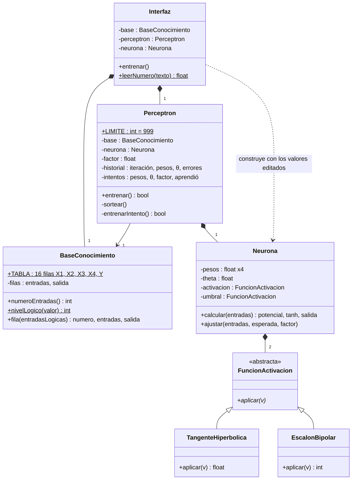

# Diagrama de clases

Siete clases. En UML, `−` es privado, `+` público, lo subrayado es de clase (`static`) y lo
que va en cursiva es abstracto. Las tablas que no tienen comportamiento propio (el historial de
iteraciones, los intentos, las filas de la compuerta) no son clases: van dentro de la clase que
las usa, como atributos.

## Las relaciones

| Relación | Tipo | Qué significa |
|---|---|---|
| `Interfaz` ◆— `BaseConocimiento` | Composición | La interfaz crea la tabla y se la pasa al perceptrón |
| `Interfaz` ◆— `Perceptron` | Composición | La interfaz crea su perceptrón y es dueña de él |
| `Interfaz` ⇢ `Neurona` | Dependencia | Cuando se editan los valores finales, construye una neurona nueva con ellos |
| `Perceptron` → `BaseConocimiento` | Asociación | Usa la tabla para entrenar, sin ser su dueño |
| `Perceptron` ◆— `Neurona` | Composición | Sortea su neurona y la entrena |
| `Neurona` ◆— `FuncionActivacion` (×2) | Composición | Tiene la tangente hiperbólica y el escalón |
| `TangenteHiperbolica`, `EscalonBipolar` ◁— `FuncionActivacion` | Herencia | Las dos son funciones de activación |
